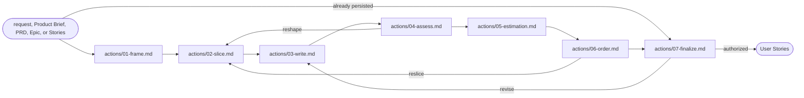

# User Stories

## Transversal rules

- Keep product and lifecycle decisions with the user.
- Separate evidence, decisions, and assumptions.
- Preserve source links and existing edits.
- Ask natural questions and never expose actions, references, or unchanged state.
- Require explicit approval or bounded authority before any write, bounded authority being a grant from a calling skill or agent that names the exact write, never a user request.
- Draft only after actor, need, and outcome are explicit in the source or confirmed.
