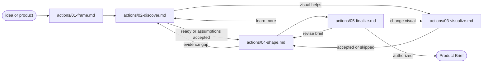

# Product Brief

## Transversal rules

- Keep product and lifecycle decisions with the user.
- Separate evidence, decisions, and assumptions.
- Preserve source links and existing edits.
- Ask natural questions and never expose actions, references, or unchanged state.
- Require explicit approval or caller-provided bounded authority before any write.
- Frame the opportunity and never write requirements.
