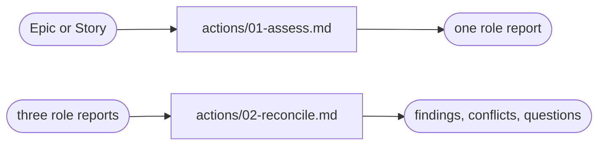

# Three Amigos

## Transversal rules

- Run one route per invocation.
- Never spawn, delegate, persist, or mutate.
- Treat roles as analytical lenses, not human authorities.
- Ground every finding and question in cited evidence and never invent a decision.
- Return proposals only, and let the caller decide what to do with them.
