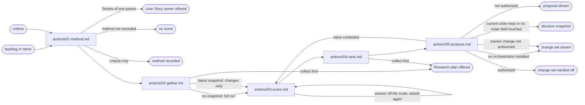

# Prioritize

## Transversal rules

- Keep product and lifecycle decisions with the user.
- Separate evidence, decisions, and assumptions.
- Preserve source links and existing edits.
- Ask natural questions and never expose actions, references, or unchanged state.
- Require explicit approval or caller-provided bounded authority before any write.
- Never propose a criterion value of your own: a criterion without mapped evidence takes the product owner's assessment, asked and flagged as a user assumption, or stays `unknown`.
- Propose a ranking and never decide it.
- Never write an order or priority field, since each artifact owner writes its own.
- Show every score with its sensitivity.
- Never write a person's name, email, or customer identifier to a file, and name a role or a segment instead.
