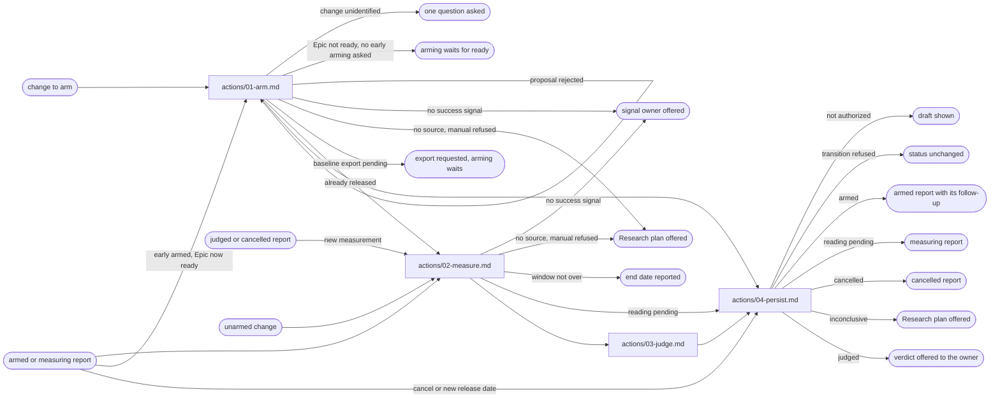

# Impact

## Transversal rules

- Keep product and lifecycle decisions with the user.
- Separate evidence, decisions, and assumptions.
- Preserve source links and existing edits.
- Ask natural questions and never expose actions, references, or unchanged state.
- Require explicit approval or caller-provided bounded authority before any write.
- Freeze the signal, baseline, and decision rule before any post-release reading, refuse a later change, and record a departure as a deviation with the user's reason.
- Treat a movement as correlation, not causation, and always list the confounders.
- Never write into an Epic or a Story, and propose the result to its owner instead.
- Keep the follow-up of a measurement only in the report's `## Follow-up` section, never in another store, and schedule a reminder through the host only when the user asks.
- Read and write aggregated figures only, never a person's name, email, or customer identifier.
